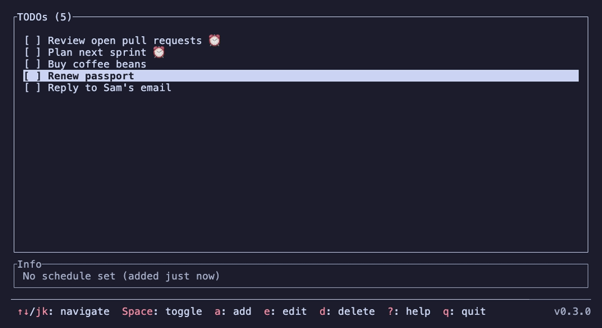

# Tuido

[](https://github.com/nicbet/tuido/actions/workflows/ci.yml)

A TUI todo app built with Rust, featuring a text-based user interface for managing tasks, scheduling, and notifications.



## Features

- **Task Management**: Add, edit, delete, and toggle completion of todos
- **Scheduling**: Set due dates using natural language (e.g., "tomorrow at 9pm", "3pm")
- **Notifications**: Desktop notifications when tasks become overdue
- **Suspend Tasks**: Temporarily suspend tasks without deleting them
- **Persistent Storage**: Todos are saved to `~/.config/tuido/todos.json`
- **Keyboard-Driven**: Efficient navigation and editing with keyboard shortcuts

## Prerequisites

- Rust (latest stable version recommended)
- Linux/macOS/Windows with terminal support

## Installation

### From a Release

Prebuilt binaries are published on the [Releases](https://github.com/nicbet/tuido/releases) page for:

| Platform | Archive suffix |
| --- | --- |
| Linux x86_64 (static) | `x86_64-unknown-linux-musl.tar.gz` |
| Linux arm64 (static) | `aarch64-unknown-linux-musl.tar.gz` |
| macOS Intel | `x86_64-apple-darwin.tar.gz` |
| macOS Apple Silicon | `aarch64-apple-darwin.tar.gz` |
| Windows x86_64 | `x86_64-pc-windows-msvc.zip` |
| Windows arm64 | `aarch64-pc-windows-msvc.zip` |

Download the archive for your platform, verify it against its `.sha256` file, extract it, and put `tuido` on your `PATH`:

```bash
shasum -a 256 -c tuido-v0.3.0-aarch64-apple-darwin.tar.gz.sha256
tar -xzf tuido-v0.3.0-aarch64-apple-darwin.tar.gz
sudo cp tuido-v0.3.0-aarch64-apple-darwin/tuido /usr/local/bin/
```

The macOS binaries are not signed. If Gatekeeper blocks them, run `xattr -d com.apple.quarantine /usr/local/bin/tuido`.

### From Source

1. Clone the repository:

   ```bash
   git clone https://github.com/nicbet/tuido.git
   cd tuido
   ```

2. Build and install:

   ```bash
   make install
   ```

   Or manually:

   ```bash
   cargo build --release
   sudo cp target/release/tuido /usr/local/bin/
   ```

### Using Cargo

```bash
cargo install --git https://github.com/nicbet/tuido.git
```

## Building

### Release Build

```bash
make build
# or
cargo build --release
```

### Debug Build

```bash
make debug
# or
cargo build
```

## Local Development

1. Run the application:

   ```bash
   make run
   # or
   cargo run
   ```

2. Run tests:

   ```bash
   make test
   # or
   cargo test
   ```

3. Lint the code:

   ```bash
   make lint
   # or
   cargo clippy -- -D warnings
   ```

4. Check code without building:

   ```bash
   make check
   # or
   cargo check
   ```

5. Re-record the README demo GIF (requires [VHS](https://github.com/charmbracelet/vhs)):

   ```bash
   make demo
   ```

   The script lives in `demo/demo.tape` and runs tuido with a throwaway `HOME`, so your own todos are never touched.

6. Clean build artifacts:

   ```bash
   make clean
   # or
   cargo clean
   ```

## Usage

Run `tuido` in your terminal to start the application. See [Configuration](#configuration) for command-line options.

### Keybindings

- **Navigation**:
  - `↑/↓` or `j/k`: Move up/down in the list
  - `Shift+↑/↓` or `J/K`: Reorder the selected task

- **Task Management**:
  - `a`: Add new task
  - `e`: Edit selected task
  - `r`: Reschedule selected task (submit empty to clear the schedule)
  - `Space`: Toggle completion of selected task
  - `s`: Suspend/unsuspend selected task
  - `d`: Delete selected task
  - `h`: Hide/show completed tasks
  - `X`: Clear all tasks (asks for confirmation)
  - `u`: Undo the last change (add, edit, reschedule, complete, suspend, delete, reorder, clear all)
  - `Ctrl+R`: Redo

- **While typing**:
  - `←/→`, `Home/End`: Move the cursor
  - `Ctrl+W`: Delete previous word
  - `Ctrl+U`: Delete to start of line
  - `Enter`: Save, `Esc`: Cancel

- **General**:
  - `?`: Show help
  - `q`: Quit the application

### Adding Tasks with Due Dates

When adding or editing a task, you can include scheduling information using natural language:

- "Buy groceries tomorrow at 5pm"
- "Call dentist 3pm"
- "Standup at 9:30"

Times can be in 12-hour (9pm, 11:30am) or 24-hour (21:30) format. A time that has already passed today is scheduled for tomorrow; "tomorrow" without a time defaults to 9am. The scheduling words are removed from the task text.

### Notifications

The app shows a desktop notification when a task becomes overdue, both on startup and while it is running. Ensure your system supports notifications (Linux: notify-send, macOS: built-in, Windows: toast notifications).

## Configuration

### Todo file location

tuido picks the todo file from the first of these that applies:

1. `-f/--file <PATH>`, for example `tuido -f ~/Dropbox/work-todos.json`
2. The `TUIDO_FILE` environment variable
3. `$XDG_CONFIG_HOME/tuido/todos.json`, if `XDG_CONFIG_HOME` is set to an absolute path
4. `~/.config/tuido/todos.json` (the default)

The directory for the default and XDG locations is created automatically on first run. For an explicit `--file` or `TUIDO_FILE`, the directory must already exist, so a typo doesn't quietly start a new, empty list.

Press `?` in the app to see which file is in use.

**Moving to the XDG location:** if `XDG_CONFIG_HOME` is set but `$XDG_CONFIG_HOME/tuido/todos.json` doesn't exist yet, tuido keeps using an existing `~/.config/tuido/todos.json`. To switch, move the file:

```bash
mkdir -p "$XDG_CONFIG_HOME/tuido" && mv ~/.config/tuido/todos.json "$XDG_CONFIG_HOME/tuido/"
```

**Synced folders and symlinks:** the todo file can be a symlink, for example into a Dropbox or Syncthing folder. Saves go to the file it points to, and the link is kept. tuido doesn't lock the file, so two instances, or two devices editing at once, overwrite each other's changes. The last save wins.

### Command-line options

```
Usage: tuido [OPTIONS]

Options:
  -f, --file <PATH>  Use this todo file instead of the default
  -h, --help         Print help
  -V, --version      Print version
```

## Releasing

CI runs formatting, clippy, and tests on Linux for every push and pull request to `main`. Release binaries are built only when a version tag is pushed:

1. Bump `version` in `Cargo.toml` and commit.
2. Tag and push: `git tag v0.3.1 && git push origin v0.3.1`

The release workflow fails if the tag doesn't match the `Cargo.toml` version. Otherwise it builds all six targets and publishes a GitHub Release.

## Contributing

1. Fork the repository
2. Create a feature branch
3. Make your changes
4. Run tests and linting
5. Submit a pull request

## License

MIT
